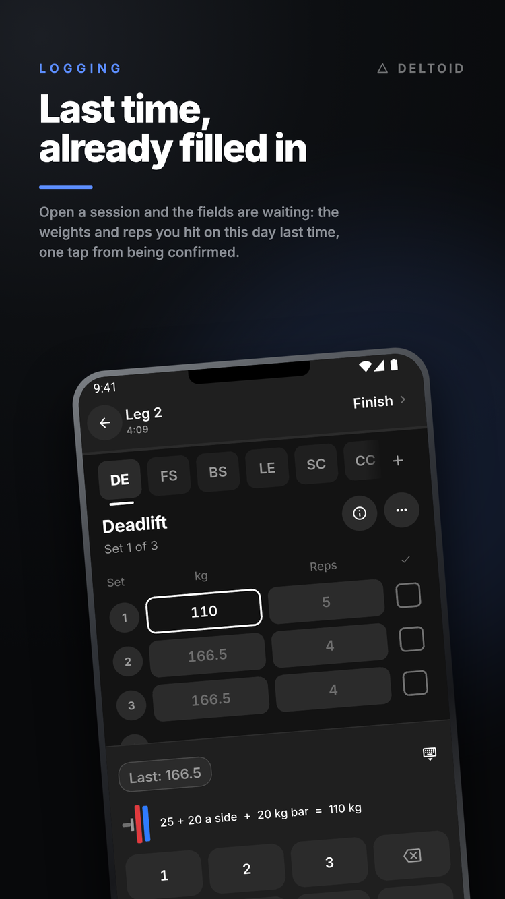
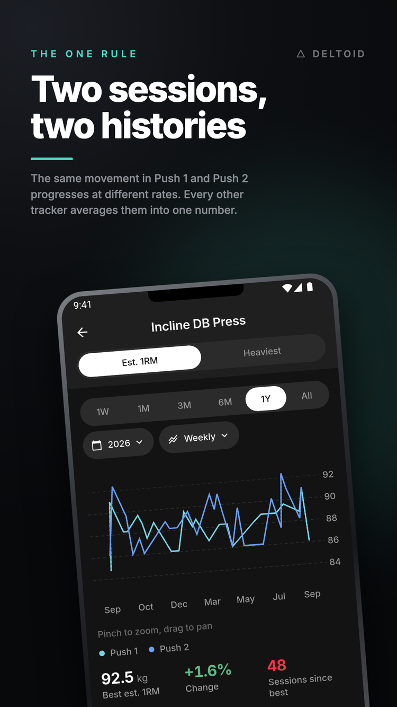
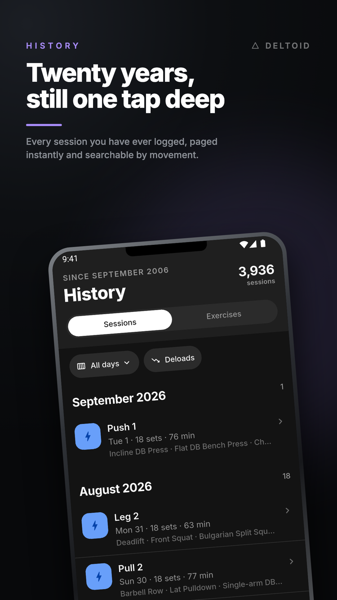
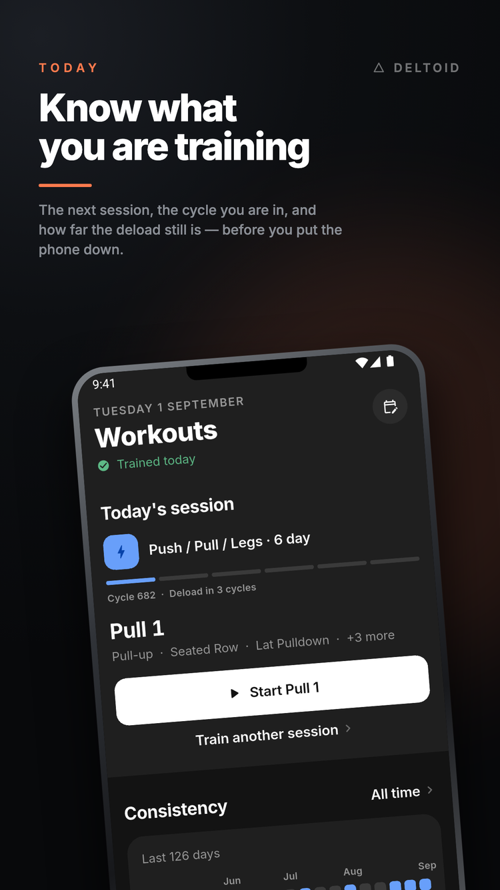
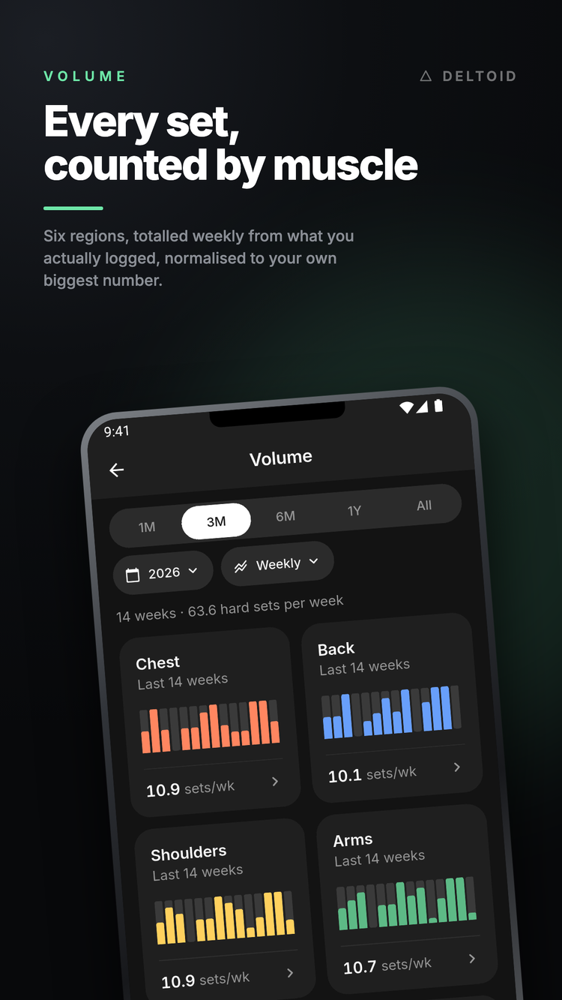
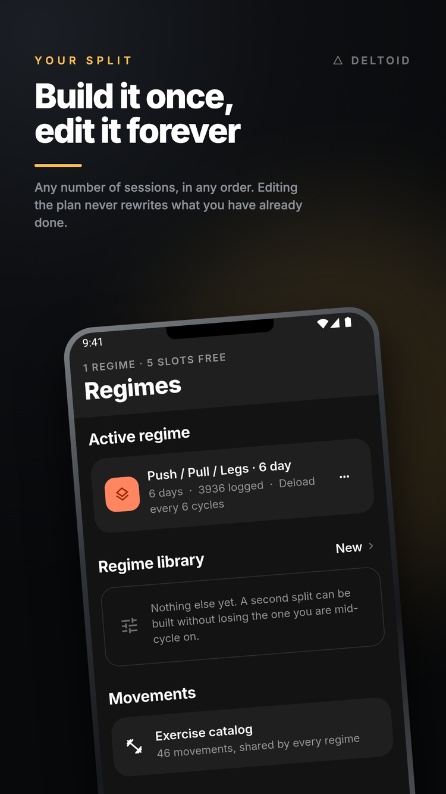

# Deltoid

Deltoid is an offline-first training log for Android, built with Flutter,
Riverpod, and drift over SQLite. It was written for a single user, and it is
published here because the problem it solves is one most training apps get
wrong.

**Progression is tracked per session, not per exercise.** If incline dumbbell
press is the first movement in Push 1 and the second movement in Push 2, those
two slots keep separate histories. When you open Push 1, the fields prefill with
what you lifted on Push 1 last time, rather than with an average of every time
you have performed the movement. Most trackers collapse both slots into a single
number, which hides the fact that the two sessions progress at different rates.

Three other properties follow from the same intent:

- **Everything is stored on the device, and no screen waits on the network.**
  The app is fully usable in airplane mode. Sync across your own devices is
  optional, and a build with no configuration cannot reach an account at all.
- **No training programme is built in.** A new install contains an exercise
  catalog and nothing else. You either build a split yourself or start from a
  template (PPL 6-day, Upper/Lower) and edit it.
- **Logged workouts are snapshots.** Editing a programme changes what you will
  do next; it never rewrites what you have already done. A set typed wrong at
  the bar can be corrected by hand afterwards, and nothing else changes a
  logged day.

<table>
  <tr>
    <td width="33.33%">
      
    </td>
    <td width="33.33%">
      
    </td>
    <td width="33.33%">
      
    </td>
  </tr>
  <tr>
    <td width="33.33%">
      
    </td>
    <td width="33.33%">
      
    </td>
    <td width="33.33%">
      
    </td>
  </tr>
</table>

## Getting the app

There is no Play Store listing. The quickest way to get Deltoid is the APK
attached to the
[latest release](https://github.com/SahilK-027/Deltoid/releases/latest):
download `app-arm64-v8a-offline-release.apk` on an Android phone and open it.
That is the offline build described below. It has no account and no server
behind it, and everything you log stays on the phone.

To build it yourself you will need the Flutter SDK (Dart `^3.11.5`) and an
Android toolchain.

```bash
git clone https://github.com/SahilK-027/Deltoid.git
cd Deltoid
flutter pub get
dart run build_runner build
flutter run
```

`build_runner` generates `lib/data/db/database.g.dart` and must be re-run after
any change to `lib/data/db/tables.dart`.

**Android is the only platform that is built and tested.** An `ios/` directory
exists and almost all of the code is platform-neutral Dart, but no iOS build has
ever been produced or verified. See [Running on iOS](#running-on-ios).

## The two builds

The app ships in two flavours, and both can be installed on the same phone at
once because they carry different application IDs.

| | Offline | Full |
| --- | --- | --- |
| Launcher name | Deltoid Offline | Deltoid |
| Application ID | `com.deltoid.deltoid.offline` | `com.deltoid.deltoid` |
| Sync | Not compiled in | Available once configured |
| Sign-in | Not offered | Google |
| Needs a server | No | A Supabase project of your own |

**The offline build is the one to share.** It has no account configuration
compiled into it, so there is nothing for it to sign in to and nothing it can
reach. The welcome screen offers only "Start training", and everything logged
stays on the device.

```bash
flutter build apk --release --flavor offline --split-per-abi
```

**The full build is for someone who has set up their own server.** It is
identical apart from being handed a configuration at build time:

```bash
flutter build apk --release --flavor full --split-per-abi \
  --dart-define-from-file=deltoid.env.json
```

Both commands write to `build/app/outputs/flutter-apk/`. `--split-per-abi`
produces one APK per CPU architecture, at roughly 26 MB each, rather than a
single 68 MB file carrying all three. Install the `arm64-v8a` one on any phone
made in the last several years:

```bash
adb install build/app/outputs/flutter-apk/app-arm64-v8a-offline-release.apk
```

To run either flavour from a laptop, pass the same `--flavor` to
`flutter run`.

## Setting up sync

Sync stays off until you give the full build something to talk to, and
everything except cross-device backup works without it. Turning it on means
running your own infrastructure — a Supabase project for the data and a Google
Cloud project for sign-in — so that nothing routes through anybody else's
account.

In outline:

1. Create a Supabase project, then apply this repository's schema to it with
   `supabase db push`.
2. Generate a release keystore, because Google identifies your app by the
   fingerprint of the key it is signed with.
3. Create a Google OAuth consent screen, one Web client, and two Android
   clients — one for your release fingerprint and one for your debug one.
4. Enable Google in Supabase's auth settings, and list your Web client ID under
   **Authorized Client IDs**.
5. Copy `deltoid.env.example.json` to `deltoid.env.json`, fill in the project
   URL, publishable key, and Web client ID, and build with
   `--flavor full --dart-define-from-file=deltoid.env.json`.

**[SETUP-SYNC.md](SETUP-SYNC.md) walks through all of it with the exact
commands**, including reading SHA-1 fingerprints, what belongs in
`android/key.properties`, and what each failure message actually means. Expect
it to take about an hour the first time.

`deltoid.env.json` is gitignored. None of the three values in it is a secret —
all three ship inside any release APK and can be extracted from it — which is
why row-level security, rather than key secrecy, is what protects the data. See
[SYNC § 3](SYNC.md#3-identity).

Anyone running a build configured against your project can sign in and create
an account on it. Row-level security keeps their data and yours separate, but
the project, its quota, and the responsibility remain yours. Share the offline
build instead.

## Status

The app is feature-complete and in daily use. All 1,285 Dart tests and nine
pgTAP tests pass, and the analyzer reports no issues. [TODO.md](TODO.md) is the
only place where status is recorded, and [CHANGELOG.md](CHANGELOG.md) says what
each release changed.

This is a personal tool rather than a product. There is no roadmap and no
support, and issues and pull requests are not being solicited. You are welcome
to fork it. The code is released under the [MIT license](LICENSE); the bundled
Inter fonts remain under the SIL Open Font License, included at
[`assets/fonts/OFL.txt`](assets/fonts/OFL.txt).

---

## Working on the code

### Commands

| Command                                                | Purpose                                                     |
| ------------------------------------------------------ | ----------------------------------------------------------- |
| `flutter run --flavor offline`                         | Run the offline build on a connected device or emulator     |
| `flutter run --flavor full --dart-define-from-file=deltoid.env.json` | Run the full build against your own server    |
| `flutter analyze && flutter test`                      | The gate. Both must pass before any change is considered done |
| `dart run build_runner build`                          | Regenerate database code after a schema change              |
| `flutter build apk --release --flavor offline --split-per-abi` | Produce the release APKs to share                   |
| `flutter test tool/test/`                              | Tests for the seed generator, which `flutter test` skips    |
| `supabase db push`                                     | Apply `supabase/migrations` to the linked project           |
| `supabase test db`                                     | Run the row-level-security suite against a local stack (requires Docker) |

Run `git config core.hooksPath hooks` once per clone, because `.git/hooks` is
not version-controlled. It points git at [`hooks/`](hooks/), whose `pre-push`
script runs `flutter analyze && flutter test` and rejects the push if either
command fails. `git push --no-verify` is the only way to bypass it.

### Project layout

```
lib/
  main.dart · app.dart      Bootstrap, theme mode, and the app shell

  domain/                   Pure Dart: no Flutter, no database, no I/O
    prefill.dart              resolvePrefill and applyDeload — the core rule
    cycle_engine.dart         Cycle status, positions, alternating days, deload scheduling
    cycle_order.dart          The words the regime editor prints about a cycle's order
    metrics.dart              e1RM, effective load, beatsPrevious, stall detection
    muscle_volume.dart        Weekly sets grouped into six muscle regions
    volume_history.dart       Weeks, spans, and rates
    chart_buckets.dart        The aggregation every chart is drawn from
    consistency.dart          Sessions per week, streaks, completion rates
    session_diff.dart         Today's improvisation compared with the template
    sync_merge.dart           resolveRow — which of two row versions wins
    catalog_merge.dart        Folding two seeded catalogs into one
    slots.dart · plates.dart · units.dart · set_format.dart · enums.dart

  data/
    db/                     tables.dart (schema), database.dart, migrations.dart,
                            table_spec.dart (every column's default),
                            invariants.dart (the structural rules, in SQL),
                            watch.dart (the only safe way to watch a query)
    repositories/           training_repository: logging, cycles, history,
                                                 progress, volume
                            regime_repository:   programmes, sessions, catalog
    seed/                   Starter exercise catalog and optional templates
    backup/                 Whole-database JSON export and restore, Downloads writer
    sync/                   sync_backend.dart (the transport interface),
                            supabase_backend.dart (the only file that imports
                            the Supabase client), sync_auth.dart,
                            push.dart (uploads locally changed rows),
                            sync_engine.dart (decides when a sync runs),
                            pull.dart (applies a batch: conflicts, collisions,
                            cursor), sync_state.dart (Local / Synced / Pending)

  core/
    theme/                  tokens.dart and theme.dart — the design language in code
    widgets/                primitives.dart (cards, rows, chips, sheets),
                            trend_chart.dart (the single chart widget),
                            calendar.dart (the single day picker),
                            reorder_sheet.dart, ticking.dart (all per-second rebuilds),
                            cycle_order.dart (the order of a cycle, drawn)
    providers.dart · sync_providers.dart · sync_scope.dart · progress.dart
    ids.dart · rest_alert.dart · failure.dart · workout_notifications.dart

  features/                 home · log · history · regime · progress · more
                            account · welcome · shell

test/                       domain · data · features · core
test/integrity/             The invariant oracle and the two fuzz harnesses
tool/seed_years.dart        Generates years of plausible training history
tool/posters/               Store-poster template and renderer
assets/audio/rest_done.mp3  The end-of-rest tone
```

The code is organised into four layers with dependencies flowing in one
direction only: `features` → `data` → `domain`, with `core` available to all
three. Repositories return plain Dart records and streams, so no widget ever
touches a database table directly. Weights are always stored in kilograms and
converted at the presentation edge.

Riverpod providers sit on top of drift streams, so any write re-renders whatever
was watching that table. This remains true when sync is enabled: screens read
local storage, and a sync is background reconciliation of the same tables.

The app has five tabs. **Home** shows the next session, the weigh-in and
workout habits, and logging a past session. **Regimes** holds programmes, the
programme editor, and the exercise catalog. **Progress** carries cycle progress
and weekly volume. **History** contains the session feed, per-exercise history,
and trend charts. **More** covers units, theme, backup, and the account.

### Testing

The suite contains 1,285 Dart tests, plus nine pgTAP tests that run behind
`supabase test db`. Alongside conventional unit and widget tests, three pieces
are worth describing:

- **`lib/data/db/invariants.dart`** defines twenty structural rules expressed in
  SQL — seventeen about the shape of the data, and three about the columns that
  sync merges depend on. The rules can be evaluated after any write.
  `test/integrity/invariant_oracle_test.dart` deliberately corrupts the database
  once per rule, so every rule has been observed to fire. These checks also ship
  in the app: a restore refuses any file that breaks a rule no repair can fix.
- **`test/integrity/model_fuzz_test.dart`** applies seeded random operations to
  both the real database and a deliberately simple in-memory model, evaluating
  the invariants after each one. On failure it prints the seed and the shortest
  operation sequence that still reproduces the problem.
- **`test/integrity/sync_fuzz_test.dart`** applies the same technique to two
  simulated devices sharing one fake account: random operations on both, syncs
  at random points, invariants after every step, and a final convergence check.
  There is no reference model here, because the merge rules themselves are what
  is under test, and a model that predicted their output would just be a second
  implementation of `sync_merge.dart`.

The fuzz run committed to the repository is small enough to sit inside the
normal suite. Environment variables turn it into a longer soak test:

```bash
FUZZ_REPORT=1 FUZZ_SEEDS=500 FUZZ_OPS=2000 FUZZ_BACKUP_EVERY=10 flutter test test/integrity/model_fuzz_test.dart
SYNC_FUZZ_SEEDS=40 SYNC_FUZZ_OPS=400 flutter test test/integrity/sync_fuzz_test.dart
```

`FUZZ_SEEDS` × `FUZZ_OPS` determines the size of the run. `FUZZ_REPORT=1` prints
how many operations each seed applied. `FUZZ_BACKUP_EVERY=N` thins out the one
operation whose cost grows with the accumulated history, because it rewrites
every row. A printed failure can be replayed exactly:

```bash
FUZZ_SEED=17 FUZZ_SEEDS=1 FUZZ_OPS=4000 flutter test test/integrity/model_fuzz_test.dart
```

### Generating test data

To exercise the app at a scale no fresh install reaches, generate a backup file
and restore it through More → Account & backup. The generated history
progresses over time, keeps each session's numbers separate, and includes deload
weeks, missed weeks, and plateaus:

```bash
dart run tool/seed_years.dart 20 --seed=7          # writes build/deltoid-seed-20y.json
dart run tool/seed_years.dart 20 --seed=7 --push   # …and pushes it to a connected device
```

Twenty years produces roughly 4,000 workouts and 67,000 logged sets in a 26 MB
file. **Restoring is destructive**: it clears every table before importing, so
export your real log first.

On an emulator, decoding a file that size inside the app is impractically slow.
`tool/seed_device.sh 20 7` builds the same history on your machine, through the
same importer, and installs the finished database directly.

### Schema changes

`schemaVersion` is currently **6**, and the migration ladder is live. A schema
change consists of four steps: edit `tables.dart`, regenerate with
`build_runner`, add a default in `data/db/table_spec.dart`, and add an
idempotent step to `upgradeSchema`. Read
[RULES § 3](RULES.md#3-schema-and-migrations) before changing any column.

Any column added to a syncable table must also be added to the server, in
`supabase/migrations/`. `test/data/server_schema_test.dart` compares the two
definitions and fails if they diverge, which is the least visible failure sync
can produce.

### The server

The part of cloud backup that is not written in Dart lives in `supabase/`:

```
supabase/
  config.toml               The shape of the local stack, committed
  migrations/*.sql          Nine tables, row-level security, indexes, server clock
  tests/database/*.sql      pgTAP tests that prove the security policies
```

The row-level-security policies are the entirety of the access control (see
[SYNC § 3](SYNC.md#3-identity)), so they are kept in the repository, where they
can be diffed and reviewed, rather than only in a browser console. Running them
requires Docker and a local Supabase stack. If Docker has only a few gigabytes
available the full stack will not fit, so start just the services the tests
need:

```bash
supabase start -x realtime,storage-api,imgproxy,studio,postgres-meta,mailpit,edge-runtime,logflare,vector,supavisor
```

Then run `supabase test db`, and `supabase stop` when you are finished.

### Running on iOS

Nothing in the app is deliberately Android-only, and every third-party package
it depends on supports iOS. Two pieces of native code are Android-specific, and
both are already guarded at the call site: `DownloadsWriter.kt`, which saves a
backup into the shared Downloads folder, and the boot channel in
`MainActivity.kt`, which holds the launch screen until Dart reports that startup
is complete. On iOS the backup would fall back to the share sheet.

An iOS build has never been attempted, and would require at least the following:

1. Xcode, which is not installed on the development machine used so far.
2. An Apple developer account and a signing profile.
3. An iOS OAuth client for Google Sign-In, with the matching URL scheme added to
   `Info.plist`.
4. A review of the rest timer. Android uses an exact alarm to fire the
   end-of-rest notification while the app is backgrounded; iOS has no equivalent
   and would need a local notification scheduled differently.
5. An iOS app icon set, and a check of the safe-area insets on notched devices.

Until someone does that work, treat iOS as unsupported rather than broken.

### Documentation

Each document has a single purpose, and no fact belongs in more than one of
them.

| File                      | Contents                                                                              |
| ------------------------- | -------------------------------------------------------------------------------------- |
| **README.md** (this file) | What the app is, how to build and run it, and where the code lives                     |
| **[RULES.md](RULES.md)**  | Every rule the app is held to: data invariants, migrations, known traps, and scope     |
| **[THEME.md](THEME.md)**  | The app screen by screen, and the design language it is drawn in                       |
| **[SYNC.md](SYNC.md)**    | The sync design: what syncs, how conflicts resolve, and what sync must never do        |
| **[TODO.md](TODO.md)**    | A single list of what has been built. Status is recorded here and nowhere else |
| [SETUP-SYNC.md](SETUP-SYNC.md) | Step-by-step setup for the full build: Supabase, Google OAuth, keystore, and env file |
| [CLAUDE.md](CLAUDE.md)    | Orientation for AI coding sessions. It points at the documents above and contains no facts of its own |

Because this is a personal tool, scope discipline is a requirement rather than a
preference. [RULES § 6](RULES.md#6-scope) lists what is deliberately excluded,
and the answer to "should this be added?" is usually no.

### Debugging on a device

- Capture a screenshot: `adb exec-out screencap -p > out.png`
- Read the on-device database. Quote the whole command, or the shell will mangle
  it:
  `adb shell "run-as com.deltoid.deltoid sqlite3 /data/data/com.deltoid.deltoid/app_flutter/deltoid.sqlite 'select count(*) from workouts'"`
- `file_picker` resolves to version 3.0.4, which is missing a namespace
  declaration and breaks the Gradle build. The app uses `file_selector` instead;
  do not switch back.
